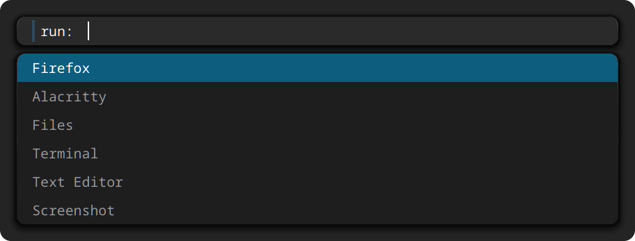

# wlmenu

A [wmenu](https://codeberg.org/adnano/wmenu)-style dynamic menu for Wayland,
written in Rust.

`wlmenu` is a layer-shell dropdown menu: type to filter, arrows to move,
Enter to select, Escape to cancel. It renders text entirely in software
(wl_shm + its own rasterizer), so there are no cairo/pango dependencies —
the whole UI is drawn by `ab_glyph`.



## Features

- wmenu/dmenu-style filtering: every space-separated query token must be a
  substring; ranking is exact > prefix > substring
- lists stream in: the menu shows immediately and rows fill in as stdin
  produces them (and while `--run` scans `.desktop` files and `$PATH`), so slow
  producers (`find / | wlmenu`) stay responsive
- `Ctrl`-free text input, `Up`/`Down`/`Ctrl-n`/`Ctrl-p`/`PgUp`/`PgDn`/`Home`/`End` navigation, key
  repeat, long-list scrolling, case-insensitive matching (`-i`), `Tab` completes
  the highlighted entry into the input; `Ctrl-c`/`Ctrl-g` cancel, `Ctrl-h`
  backspace, `Ctrl-j`/`Ctrl-m` accept, `Ctrl-u` clears the line, `Ctrl-w` kills
  the last word, `Shift-Return` submits exactly what was typed, and
  `Ctrl-Return` multi-selects (prints each pick, keeps running)
- Spotlight-style UI: rounded corners; the input bar and the result list are two
  separate cards with an 8 px gap between them; launch shows only the input bar in the
  upper-center of the screen, results appear as you type, and the menu
  collapses back to the bar when the query is cleared. Height changes ease over
  120 ms instead of jumping. With `-p` the list is shown from the start and
  Enter takes the highlighted row, so `printf 'no\nyes' | wlmenu -p 'Suspend?'`
  is a usable confirm dialog
- the panel is translucent glass: an antialiased rounded edge, a hairline along
  it, and a two-layer drop shadow that wraps the rounded corners instead of being
  cut off by them — the same chrome numbers as [plush](https://github.com/codethare/plush).
  There is no background blur (that needs a compositor
  protocol), so a busy wallpaper is best handled with a higher alpha
- text is antialiased with LCD subpixel filtering on 1× outputs (sharper on a
  normal-DPI screen) and neutral grayscale AA on HiDPI, where subpixel only
  costs time and adds colour fringes
- `--run` launcher mode: scans `.desktop` files and launches the selection
  via `sh -c` — and merges in everything on `$PATH`, deduped with the desktop
  entries winning. Hidden entries, `Terminal=true` entries, entries for other
  desktops (`OnlyShowIn`/`NotShowIn`), and non-executable PATH files are
  skipped; a localized `Name[locale]` is preferred when it matches the locale.
  The launched process gets an xdg-activation token in
  `XDG_ACTIVATION_TOKEN` so its window can take focus.
- one panel per Wayland session: launching `wlmenu` again dismisses the running
  menu (same as Escape, no output, exit 1) instead of stacking a second bar on
  top of the first — so a launcher keybind toggles open/closed
- CJK text renders: a small Latin mono face is the primary font and the
  CJK/icon faces are read on demand, so startup does not pay for the 27MB CJK
  face unless a glyph actually needs it

## Build / run

```sh
cargo build --release
```

Modes:

```sh
# stdin → menu → selection printed to stdout
printf 'firefox\nFirefox\nalacritty\n' | wlmenu

# launcher (desktop entries + PATH scripts/commands)
wlmenu --run

# with filters
printf 'alacritty\nfirefox\n' | wlmenu -i -p 'run: '
```

Options (wmenu-compatible subset): `-b` (menu at screen bottom), `-P` (mask typed
input as asterisks), `-i` (case-insensitive), `-l lines` (visible rows), `-W width`
(default: 45% of the output width, clamped to 480-960 px, with the text size
following it),
`-p prompt`, `-o output` (show on the named output), `-f font.ttf|"FAMILY [style] [pt|Npx]"` (bare size is points, `Npx` is
pixels — wmenu/Pango convention), `-v` (print version), `--run`, `-h`.

Colors are wmenu-style `RRGGBB[AA]`: `-N` normal bg, `-n` normal fg, `-M` prompt bg,
`-m` prompt fg, `-S` selection bg, `-s` selection fg. The default backgrounds are
translucent (`1e1e1ed4`, `2c2c2cdc`, `0b6285ee`); an alpha below `ff` blends the
panel with the wallpaper. Example:

```sh
printf 'alacritty\nfirefox\n' | wlmenu -N 111111 -n cccccc -S 005577 -s ffffff
```

### Sway

```conf
set $menu wlmenu --run
bindsym $mod+d exec $menu
```

## Manual

`docs/wlmenu.1` is a roff manual page. View it with `man ./docs/wlmenu.1`, or
install it with
`install -Dm644 docs/wlmenu.1 /usr/share/man/man1/wlmenu.1`.

## Known limits

- No IME: typing CJK into the filter field needs a Wayland input-method
  protocol client, same as wmenu. Filtering CJK *labels* works fine.
- Long stdin lists are capped at 64 visible rows and scroll (keeps the shm
  buffer bounded); pass `-l N` for a fixed height.
- The `--run` activation token carries only the surface, no input serial (sctk
  drops it), so compositors that insist on a serial may still not focus the
  launched window.
- Fractional output scaling (1.25/1.5) renders at the output's integer scale;
  HiDPI integer scales (2x) render natively crisp.
- Subpixel antialiasing assumes an RGB-stripe panel. On a BGR panel (text
  fringing on the wrong side) set `main::TEXT_AA` in `src/main.rs` to
  `render::Subpixel::Bgr`, or to `Gray` to disable it everywhere.